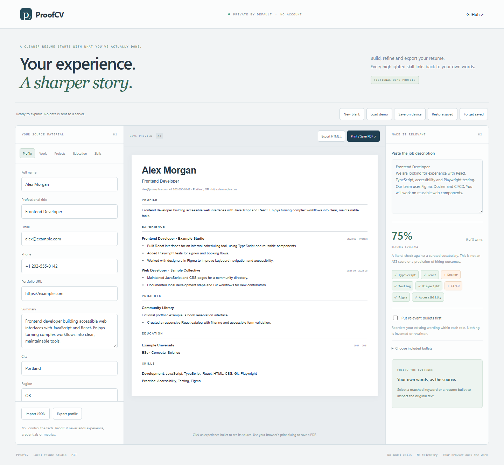

<p align="center"><strong>p ✓ PROOFCV</strong></p>
<h1 align="center">Your experience.<br>A sharper story.</h1>
<p align="center">A private, local resume studio with source-linked keyword checks.<br>Build from your real experience. Keep the evidence. Export a clean draft.</p>
<p align="center"><a href="https://aliemami81.github.io/proofcv/">Try the resume studio ↗</a> · <a href="#use-the-agent-skill">Agent skill</a> · <a href="#privacy-and-storage">Privacy</a> · <a href="#what-it-does-and-does-not-do">Limits</a></p>
<p align="center"><a href="https://github.com/AliEmami81/proofcv/actions/workflows/tests.yml"></a>  <a href="LICENSE"></a></p>



## Start in a minute

**[Open the live studio](https://aliemami81.github.io/proofcv/)**, explore the clearly
labeled fictional profile, then choose **New blank** to enter your own experience.

1. Edit your profile, work, projects, education and skill groups.
2. Paste a job description. Click a matched keyword to inspect its source.
3. Optionally put relevant bullets first or deselect a bullet.
4. Export HTML or use **Print / Save PDF**. Export the profile JSON as a backup.

No account, model service, API key or subscription is required. To run offline,
clone the repo and open `index.html` directly in a modern browser. Alternatively,
Node.js 22+ can run the optional local server:

```sh
git clone https://github.com/AliEmami81/proofcv.git
cd proofcv
npm run dev
```

Open `http://127.0.0.1:4173`. There are no packages to install and no build step.

## Why evidence matters

A job description says what an employer wants. It does not prove that you have
that experience. ProofCV links a matched term to fields such as
`work[0].highlights[1]`, so you can inspect the original wording before using it.

**Focus mode reorders existing bullets; it never rewrites them.** The optional
agent skill can help draft better wording, but requires every claim to remain
grounded in user-supplied facts and a separate change ledger.

| Capability | Behavior |
| --- | --- |
| Live editor | Edit supported fields and see the resume update |
| Keyword coverage | Match a curated English vocabulary against your supplied text |
| Evidence inspector | Trace matched terms and resume bullets to original fields |
| Role focus | Reorder bullets within each role by recognized keyword overlap |
| Bullet selection | Omit bullets from the displayed/exported resume without deleting source data |
| Exports | Printable HTML, browser-generated PDF, and profile JSON |
| Local save | Explicitly save, restore or forget a workspace on this browser |

## What it does and does not do

The displayed percentage is **literal keyword coverage**, not an ATS score,
competency assessment or prediction of hiring outcomes. It measures how many
recognized vocabulary terms in a pasted job description also appear in supported
resume source fields. It is unweighted: a required skill and a passing mention
count equally. Negations are not understood. An ad saying “no Java required” can
still produce a Java term; review the actual requirements yourself.

The vocabulary is currently a small, curated English set covering common
development, design and business terms, with aliases such as JS/JavaScript and
k8s/Kubernetes. Unknown terms, semantic equivalents outside the alias list and
non-English job requirements are not scored. No recognized terms means no
percentage, not a failing score. Matching a term only establishes that the user
wrote it, not that the claim is verified.

Coverage searches profile summary, role context, project/education/skill fields
and included highlights; contact details and the professional-title field are
excluded. Excluded highlights do not count toward coverage. A term can still be
matched elsewhere in the profile. Each keyword button shows one source and the
number of additional sources, if any.

The app does not generate experience, invent numbers, scrape job sites, parse
PDF/Word resumes, submit applications, write cover letters or call an LLM. It
ships one plain resume layout. Unicode text and automatic content direction are
supported; the interface is English. Review dates, line breaks, terminology and
all factual claims before using a resume.

## JSON import and export

The supported shape is a subset of [JSON Resume](https://jsonresume.org/schema):

```json
{
  "basics": {"name": "Your name", "label": "Your title", "summary": "Your actual experience"},
  "work": [{"name": "Organization", "position": "Role", "highlights": ["A supported achievement"]}],
  "projects": [{"name": "Project", "description": "What it does", "highlights": []}],
  "education": [{"institution": "Institution", "studyType": "Qualification", "area": "Field"}],
  "skills": [{"name": "Development", "keywords": ["Python"]}]
}
```

Supported display sections: `basics`, `work`, `projects`, `education`, `skills`.
Unknown sections are preserved when exporting JSON but are not rendered. Import
displays a notice when such sections are present. This is not a complete JSON
Resume schema validator. Known string fields, array shapes and size bounds are
checked. A profile supports up to 50 entries per section and 100 highlights or
keywords per entry, with a 250,000-character total limit.

**Export profile** keeps the complete original profile, including deselected
bullets. It does not include the job text or focus/selection settings. HTML/PDF
reflect the displayed selection and order. A saved local workspace includes the
profile, job description, selections and focus setting.

Blank end dates display as **Present** when a start date exists; fill an end date
for completed roles. Dates are display strings, not verified chronology.

## PDF output

Choose **Print / Save PDF**, select **Save as PDF**, A4, and disable browser headers
and footers if enabled. Only the resume is printed; editor controls and job text
are hidden. Content stays selectable text instead of becoming a screenshot.
Long resumes can span pages. The in-app preview shows content rather than exact
pagination; inspect the browser's print preview before saving.

The fictional sample has been rendered as a one-page A4 PDF and its text checked.
Different fonts, browsers, scripts and content lengths can change pagination.

## Privacy and storage

The application has no backend, analytics, remote fonts, model calls or automatic
profile upload. The static host receives normal page/asset requests; resume and
job text are processed in the page. Links only navigate when clicked.

By default, edits live in page memory and are lost on reload. **Save on device**
uses this origin's browser local storage; it is not encrypted and other users of
the same browser profile may access it. Restore is explicit. **Forget saved**
removes only ProofCV's saved workspace and leaves the current editor open. Browser
storage may be unavailable for local files or restricted modes; JSON export is
the reliable portable backup. Downloads and PDFs contain personal information.

HTML exports escape content and only link HTTP(S) URLs. No imported HTML or
scripts are executed. This is a local editing tool, not a vault for sensitive data.

## Use the agent skill

Copy [`skills/proofcv`](skills/proofcv) with its `references` folder into your
agent's supported skill directory. Then ask:

> Use the proofcv skill to tailor my supplied profile for this job description.
> Keep every claim grounded in my experience. Give me an importable JSON profile,
> a source-to-rewrite change ledger, and any factual questions you cannot resolve.

Keep original data private and review the draft. Using a separate agent follows
that agent's normal permissions, data handling and usage limits. The app itself
does not send information to an agent or AI provider.

## Development and contributions

```sh
npm test
```

Eight test groups cover validation, Unicode/punctuation aliases, source pointers,
coverage, omission, exact-wording reordering, HTML escaping, unsafe URLs and blank
profiles. CI runs Node.js 22/24 on Windows and Linux. Browser smoke checks cover
editing, source inspection, focus, bullet omission, navigation and missing terms;
desktop/mobile rendering is checked for overflow and script errors.

Contributions should include a minimal fictional example, expected behavior and
regressions. Vocabulary additions should explain aliases and false positives.
AI-assisted work is welcome with reviewed behavior and test evidence. Do not add
unsupported ATS claims or automatic external uploads.

Related tools solve broader workflows, including
[Reactive Resume](https://github.com/AmruthPillai/Reactive-Resume) and
[JSON Resume](https://jsonresume.org/). ProofCV focuses on a small offline editor
with literal, source-linked job alignment. No claim of unique invention or hiring
success is implied.

MIT © Ali Emami
